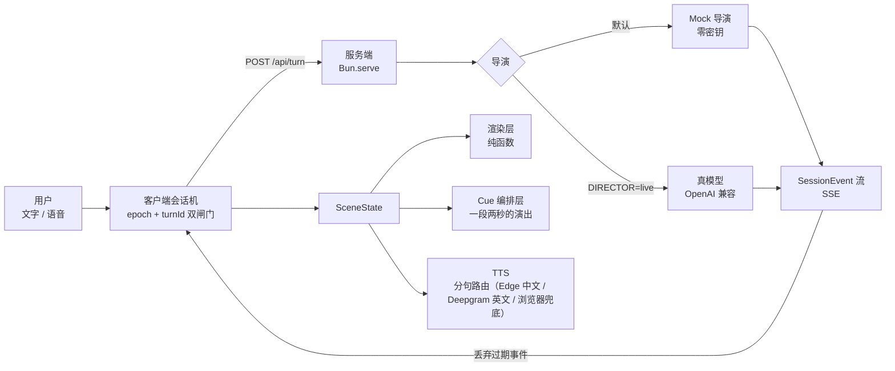

# Mira · 打烊前的咖啡馆

一个实时语音互动的**场景化角色产品**的 MVP：用户面对的不是聊天消息列表，而是一个身处具体环境中的角色——暴雨后的夜晚，26 岁的旅行摄影师 Mira 穿着琥珀色雨衣、别着银色星星发夹，在即将打烊的咖啡馆里等一个不愿说出原因的人。

角色会说话、会改表情和动作、会因为你的一句话触发一段画面演出（闪电、雨势、镜头抖动、灯光变暗）。她说话时你可以**打断**她，打断之后她真的会停下来。

> 打断的**主路径是「打断」按钮 / Esc 键 / 直接打字**这三种人工触发；「开口即打断」的能量 VAD 只是**实验特性**（外放时会被她自己的声音干扰，已加回声守卫，见「已知问题」）。

> 这是 72 小时 take-home 的实现。设计取舍、已知问题与下一步演进都写在本文件里，没有藏着。
> 演示地址：<https://mira.nolo.chat>（Mock 导演，零密钥，打开即用）
> 演示脚本：[`docs/demo-script.md`](docs/demo-script.md)　AI 使用说明：[`AI_USAGE.md`](AI_USAGE.md)
> 换一台机器跑起来 / 部署上线 / 对着麦克风测打断：[`docs/deploy.md`](docs/deploy.md)

## 快速开始

```bash
bun install
bun run dev          # 前端 5173 + 服务端 8787，一条命令
```

打开 <http://localhost:5173> 即可。**不需要任何 API 密钥**——默认 Mock 导演，完整流程（文字、语音、打断、演出、失败降级）都能跑。

接真模型（可选）：

```bash
DEEPSEEK_API_KEY=<key> DIRECTOR=live bun run dev
```

也可用 `MIRA_LLM_BASE_URL` / `MIRA_LLM_API_KEY` / `MIRA_LLM_MODEL` 指向任意 OpenAI 兼容端点（优先级最高）。

按会话切换导演（评审只想在一个标签页里看真模型时用这个）：

- 打开 <http://localhost:5173/?director=live> → **这个会话**请求真模型；不带参数 = 服务端默认档（默认 Mock）。同一浏览器两个标签页可以一个 Mock 一个真模型，互不影响。
- 没配密钥时请求 `live` 不报错、不挂起：**温和回落 Mock**，状态条 / 模式 chip / 诊断区「导演回落」会写明「请求真模型，但服务端未配置密钥」，`/api/session` 的 `keyless` 仍诚实为 `true`。
- `DIRECTOR=mock` 是强制档（URL 请求 `live` 也无效，回落原因 `forced-mock`）；`DIRECTOR=live` 表示所有会话默认 live（本地开发 / 录屏用）。档位在建会话时定下，之后每轮 turn 都沿用它。
- 成本提醒：只有「带 `?director=live` 且服务端配了 key」的会话才会真的调用模型（按 token 计费）；默认路径与无密钥部署零成本。

生产构建：`bun run build && NODE_ENV=production bun run start`（服务端会从 `dist/` 提供静态文件）。

## 架构



四个模块，边界刻意画清楚：

| 模块 | 职责 | 关键文件 |
|---|---|---|
| 协议 | 指令与事件的**唯一契约**，前后端共用类型 | `src/shared/protocol.ts` |
| 服务端 | SSE 流、会话历史、导演、指令白名单校验 | `src/server/**` |
| 会话机 | 状态归约、打断、迟到事件丢弃、语音链路 | `src/web/state/**`、`src/web/voice/**` |
| 渲染 | 纯展示，不自己发请求；演出编排 | `src/web/stage/**` |

**渲染层是纯函数**：`SceneState + Directive → SceneState`。同一个状态喂给渲染层永远得到同一画面，所以 Mock 导演、真模型导演、以及将来的回放模式**共用同一条渲染路径**——回放不需要另写一遍动画。

## 打断是怎么做对的

题目里最硬的一条是：打断后「上一轮迟到的网络响应不得覆盖当前状态或重新播放」。只调用 `AbortController.abort()` 是不够的——已经离开服务端、正在网络里飞行的事件帧收不回来。

所以用**双闸门**：

1. 客户端维护单调递增的 `epoch`，每次打断 +1，并写进请求；
2. 服务端把 `epoch` **原样回显**到每一条事件上；
3. 客户端入口 `reduceEvent()` 先比 `epoch`、再比 `turnId`，不匹配的直接丢（`stale-epoch` / `stale-turn`），碰不到状态；
4. 音频播放器在 `epoch` 变化时立即 `stop` 并清空队列；
5. 浏览器 TTS（`speechSynthesis`）用**代际令牌**忽略过期 `onend` 回调——否则「打断后状态又被拉回 speaking」是必然出现的假象。

界面上有一行 **「丢弃迟到事件 N」**，是这条护栏的可见证据：打断之后旧事件还在往回飞，但进不来。

验收方式不是「看起来对」：真服务端上**连续打断 10 次**，每次断言 `turn.end{interrupted:true}` 是最后一条事件、事件里的 `epoch` 只有一个值。结果 10/10 通过。

## 角色与场景指令

模型（或 Mock 脚本）不直接改 DOM，只产出结构化指令：

```ts
type Directive =
  | { kind: "emotion"; emotion: "neutral" | "curious" | "warm" | "amused" | "anxious" | "sad" | "surprised" }
  | { kind: "pose"; pose: "stand" | "lean_in" | "turn_away" | "hold_cup" | "glance_window" }
  | { kind: "action"; action: "blink" | "hair_tuck" | "sigh" | "shiver" | "look_back" | "nod" | "startle" }
  | { kind: "camera"; move: "push_in" | "pull_back" | "whip_pan" | "shake" | "settle" }
  | { kind: "vfx"; vfx: "lightning" | "rain_heavy" | "rain_light" | "warm_glow" | "lights_dim" | "steam_wisp" }
  | { kind: "scene"; scene: "cafe_night" | "cafe_closing" | "window_rain" }
  | { kind: "branch"; options: { id: string; label: string }[] };
```

真模型输出必须过**白名单校验**（`src/server/scene/validate.ts`），非法枚举值直接丢弃——不信任模型。

**演出编排（cue）** 把离散指令编成一段有时长的演出：闪电 → 120–260ms 后雨势变化 → 镜头抖动 → 角色一颤。四套模板（storm / window_call / warm_beat / close_down）按指令语义命中，**闪电只在 storm 里存在**（有结构性测试锁死），所以「不管你说什么都放闪电」在结构上不可能发生。400ms 内同类触发会合并、打断时旧 cue 淡出而不是硬切。

## 「多模态」到底做了什么：角色动画 + 一段真媒体

题目要求至少一种多模态表现。这里做了两层，**分别承担不同的考点**。

### 第一层：程序化分层角色动画（承担「角色表演」）

SVG + CSS 分层（发/脸/眉/眼/嘴/雨衣/发夹/袖口），7 情绪 × 5 姿势 × 7 动作 × 4 状态，**零素材授权风险、无 GPU 依赖、可被指令逐层驱动**。代价我承认：表现力上限低于 Live2D/Rive。为此补了身体参与的动作（别头发时肩/躯干/手臂/下摆一起动，不只动脸）和 cue 演出编排。

### 第二层：一段**真的**媒体片段（承担第 ⑤ 条的媒体四态）

`public/clip/storm-strip.png` 是**程序化生成的 12 帧 spritesheet**（320×180 × 12，145KB；由 `scripts/gen-clip.mjs` 在 canvas 里画出来，再用自写的调色板量化压到 Chrome 直出大小的 1/6），由 `src/web/stage/clip/` 的 canvas 播放器逐帧播放。

它是一个**有 URL、有字节、要解码、会 404、能被 abort 的资源**，所以第 ⑤ 条要求的四态都有真实载体：

| 态 | 触发 | 行为 |
|---|---|---|
| 加载中 | 命中暴雨演出后 `fetch` 期间 | 「片段载入中」轻提示，角色与对话继续，不阻塞输入 |
| 播放结束 | 12 帧播完（约 1 秒） | 自动隐藏回落角色，诊断记录「播放结束」 |
| 中途打断 | 会话 epoch 变化 / 新一轮开始 | 立刻停帧隐藏，之后的回调不再把画面拉回 |
| 失败 | 404 或解码失败（`?demo=media` 可当场演示） | 静默降级为角色画面，**诊断区留可见记录**，控制台不静默吞错 |

### 边界与未实现项

- **视频生成与长视频片段**：未做（无 GPU/视频模型通道，用程序化 spritesheet 代替）。
- **生成式插图的身份一致性**：已接 Cloudflare `flux-1-schnell` 生成插图（带配额与哈希缓存），但只能约束服装与环境风格，**做不到跨场景同一张脸**（参考图 `flux-2-dev` 亦证伪）。
- **语音合成**：已接 Edge TTS 中文（服务端代理，零密钥可用）与 Deepgram 英文（需凭据），通过 `RoutedTTS` 分句路由；当 Edge 依赖/环境/网络不可用或无相关凭据时，温和降级至浏览器 `speechSynthesis` 兜底。纯流式 `StreamTTS`（`audio.chunk` 链路）协议与客户端代码已就绪，但未连官方实时流端点。

这里不偷换概念：上面那张表说的是**媒体四态**，不是把角色状态机包装成媒体生命周期。


## 失败与降级

评审可以当场弄坏它，都能看到明确反馈：

| 故障 | 怎么触发 | 你会看到 |
|---|---|---|
| 服务未启动 | 不起服务直接开页面 | 提示条 + 「重新连接」，角色照常预览，不白屏 |
| 会话中途断线 | 对话中杀掉服务端 | 提示条转为断线；重启后点「重新连接」可继续，角色状态与历史不丢 |
| 首字超时 | `?demo=timeout` | 8s 后提示「模型 8s 内没有响应」+ 重试，状态回到待机（不卡 thinking） |
| 请求失败 | `?demo=fail` | 走真实失败分支 + 重试；第二次请求恢复正常 |
| TTS 抛错 | `?demo=tts` | 红色提示条说明「会影响角色表演，但文字对话仍可继续」 |
| 麦克风被拒 | 浏览器弹权限时点拒绝 | 区分「权限被拒 / 浏览器不支持 / 非安全上下文」三种文案，都给替代入口（打字、按住说话） |
| 渲染期异常 | Stage 抛错 | 画面区降级为提示 + 「重新渲染画面」，dock 仍可用 |

`?demo=*` 是**录屏专用**开关：注入的是真实代码路径上的故障，不是假提示；右上角会标注「演示模式：人为故障」，且只注入一次、重试即恢复。

## 第三方服务与语音通道

这一节只写**实测过**的东西，附上判据。

| 能力 | 服务 | 实测结论 |
|---|---|---|
| 真模型导演 | 任意 OpenAI 兼容端点（本次用 lithosai `DeepSeek-V4.1-Flash`） | `?director=live` 时页面真跑通，首字 639ms；默认 mock，避免公开站烧额度 |
| **语音识别（STT）** | **Deepgram `nova-2`，`language=zh`** | 走服务端 WS 代理（key 不进浏览器）。实测一句中文得到 `1× speech_started + 3× interim + 1× final`，**final 在说完后约 1.1 秒**出现 |
| **语音识别（STT，第二通道）** | **阿里百炼 `qwen-audio-3.0-asr-flash-streaming`（真流式）**（`DASHSCOPE_API_KEY`） | Deepgram key 被吊销时的回退：配了百炼 key 就**优先**走它，浏览器端协议不变（客户端感知不到换了供应商）。**真流式**：浏览器送 MediaRecorder 的 webm/opus 分块 → 服务端用 ffmpeg **边收边转**（显式 `-f webm`，16k mono s16le）→ 边转边喂上游 → 上游**边说边出字**（`interim` 持续增长），句末给 `final`。**不发 `speech_started`**（不伪造：假信号会让打断在错误时机触发），客户端 `bargeInSource` 因此退到 energy VAD。整段识别（`fun-asr-flash-2026-06-15`，无 interim）保留为可配置回退：`ALI_ASR_MODEL=fun-asr-flash-2026-06-15` |
| 语音合成（英文） | Deepgram `aura-asteria-en`（服务端代理） | 返回真 MP3（实测 15,046 字节、MPEG 魔数正确）；走本项目既有的 `audio.chunk` 播放路径 |
| 语音合成（中文） | **Edge TTS `zh-CN-XiaoxiaoNeural`**（服务端代理，非官方接口） | 音色可调（`--rate/-8% --pitch/-3Hz`）以贴近角色设定。**客观验证**：合成中文再经 Deepgram STT 转回，原句一字不差、置信度 **1.00**；同法测 Deepgram 自带的中文 TTS 只得 0.56（「外媒体验再次一码」）。代价：**每句 1.7–2.0 秒**（含 python 启动），第 1 句遮不掉，第 2 句起靠预取藏进播放时间 |
| 参考图条件生成 | Cloudflare `flux-2-dev`（multipart 提交参考图） | **实测结论：保造型、不保脸。** 用同一张定妆照作参考、prompt 明写「identical face」，生成的人脸是三个不同的人；第二张连雨衣都丢了。所以「跨场景同一个人」这条**不能靠它实现**，只能靠「角色只生成一次 + 只换背景」 |
| 生成式插图 | Cloudflare Workers AI `flux-1-schnell` | 实测 2.2–8.3 秒、约 600KB JPEG；三层配额（每会话 2 张 / 每日 60 张 / 未配置静默不可用）+ prompt 哈希缓存（命中不计配额） |
| HTTPS | Caddy + Let's Encrypt | 自动签发，SSE 经反代实测真流式（首末事件间隔 1372ms） |

**为什么 STT 必须走服务端代理**：`POST /v1/auth/grant` 在这个 key 上是 403，签不出短时 token；没有安全的浏览器直连方案，所以 key 只留在服务端，浏览器连我们自己。

**为什么 STT 说完到出终稿要 1.1 秒**：语流结束需要上游做 endpointing（300ms）后再返回 `final`；我们的代理在客户端 `stop()` 时发 `finish_utterance` → 服务端向上游发 `CloseStream` 并等待尾段（上限 1500ms），拿到 `final` 才关闭。这个延迟是上游判定，不是我们攒块。

**明确没接的**：ElevenLabs（key 401 失效）、OpenRouter（账号级 403）、Gemini Live（无 AI Studio 凭据——它能原生输出中文语音，但接入意味着重写打断链路，笔试窗口内不做）。`audio.chunk` 路径的**真 MP3 在浏览器里解码播放**这一步尚未验证（目前只验证了真 MP3 字节由代理正确产出 + 时序被 stub 覆盖）。

## 可选扩展：逐条状态

题目说这些「均不是必须项」。这里如实列出做到什么程度，不做的会写原因。

### 实时语音

| 项 | 状态 | 说明 |
|---|---|---|
| 自动检测开口并自然打断 | **做** | Deepgram `speech_started` 触发 + 浏览器 AEC；提供 `?bargeIn=off` 关闭 |
| 区分真打断与「嗯」「对」附和 | **部分** | 靠「最短持续时长 + 打断后防抖」过滤，不做语义判别 |
| 回声消除 | **部分** | 用浏览器 `getUserMedia` 的 `echoCancellation`；实测值会打进诊断（部分环境静默忽略） |
| 流式字幕 | **做** | STT `interim_results`，边说边出字 |
| 首包延迟 / 关键阶段耗时 | **做** | `timings.firstText / firstDirective / total` + 诊断面板 |
| 断线重连与会话恢复 | **做** | 手动与自动退避重连（1/2/4/8s 退避，5 次上限），状态与历史保留 |

### 角色表演

| 项 | 状态 | 说明 |
|---|---|---|
| 口型同步 | **做** | 4 相位，按字幕节奏（照片版按音频播放位置 + 快语速退化为两态） |
| 眨眼 / 呼吸 / 视线 / 待机 | **做** | 随机眨眼（含双眨）、4.6s 呼吸、倾听/思考位移 |
| 动作优先级、中断和自然衔接 | **做** | 动作跑独立子层、不打断姿态过渡；实现动作优先级队列（startle 6 > shiver 5 > hair_tuck 4 > look_back 3 > sigh 2 > nod 1 > blink 0），上限 3 槽，blink 不占队列 |
| 情绪平滑过渡 | **做** | 独立样式集交叉淡入 |
| 音频驱动的角色动作 | **未做** | `AnalyserNode` 目前只用于麦克风 VAD |
| 配置驱动的角色/动作系统 | **故意未做** | 会变成「通用动画框架」，对这道题是纯成本（见「取舍」） |

### 视频演出

| 项 | 状态 | 说明 |
|---|---|---|
| 片段预加载与无黑屏切换 | **做** | 有「载入中」提示且不阻塞；支持 `requestIdleCallback` 预取定妆照与片段素材（`saveData` 自动跳过） |
| 字幕/语音/视频时间线同步 | **未做** | 片段 1 秒，与语音无帧级对齐 |
| 全屏片段与常驻角色衔接 | **做** | 满屏 cover，结束自动回落角色 |
| 加载失败后的降级 | **做** | 404/解码失败 → 静默回落 + 诊断留痕（`?demo=media` 可演示） |
| 透明视频 / 遮罩 / 分层合成 | **未做** | 当前片段不透明满屏 |

### 生成式图片与视频

| 项 | 状态 | 说明 |
|---|---|---|
| 用角色参考图生成新场景 | **证伪** | 实测 `flux-2-dev` 参考图**保造型不保脸**：同一张定妆照生成三张是三个人，换装也会丢。这条路在当前通道下不可行 |
| 保持外观/服装/环境连续性 | **部分** | 只做到「服装与环境靠 prompt 前缀约束」；**人脸不连续** |
| 关键节点生成短视频 | **未做** | 无视频生成通道 |
| 生成期间用现有动画承接 | **做** | 「正在生成这一幕…」+ 角色继续表演 |
| 缓存与复用 | **做** | prompt 哈希缓存，命中不计配额、不联网 |
| 失败检测与重生成 | **部分** | 服务端判据齐全并重试一次；客户端不重生成，一次失败即静默回落 |

### 工程扩展

| 项 | 状态 | 说明 |
|---|---|---|
| Provider 可替换 | **做** | Director（Mock / OpenAI 兼容）、TTS（浏览器 / Deepgram / Edge）、STT（Web Speech / Deepgram / 阿里百炼） |
| 统一处理取消信号 | **做** | `AbortSignal` 贯穿导演、SSE 推送、客户端 in-flight、音频播放 |
| 记录主要状态事件 | **部分** | 有 timings、丢弃计数、守卫统计、片段失败记录；无完整事件日志 |
| 会话回放 / 问题诊断 | **部分** | 诊断面板齐全；回放未做（事件流有序，存下来即可回放） |
| 自动化测试 | **做** | 391 用例（早期快照），本轮全量跑通 58 文件 739 个测试（0 fail / 0 skip，分 5 批执行，以实际 `bun test` 运行为准），覆盖陈旧事件丢弃、打断代际令牌、并发闸门、cue 编排、片段四态、配额与缓存 |
| 观测页面 | **做** | 支持折叠式诊断面板及 `?obs=1` 独立观测抽屉（展示分段耗时 p50/p95、错误与 TTS 调用统计） |


## 已知问题

- **跨场景「同一张脸」做不到**：`flux-2-dev` 的参考图是风格条件而非身份条件（实测三张不同脸，换装也会丢）。当前能做的一致性上限是「角色生成一次、只换背景与光照」。
- **中文语音第 1 句延迟 1.7–2.0 秒**（Edge TTS 含进程启动）；第 2 句起靠预取掩盖。
- **`audio.chunk` 只验证到「解码」这一步**：线上真实中文 MP3 能在浏览器里 `decodeAudioData` 成功（实测时长 4.03s / 1 声道 / 48kHz），但**真正出声**这一步在本机无法验证（这台机器的 Chrome 没有任何 TTS 语音、也没有可用扬声器回路）。播放时序、打断即停这些逻辑仍只有 stub 覆盖。

- **生成图与 SVG 角色不是同一张脸**：prompt 只能约束「26 岁 / 琥珀雨衣 / 星星发夹 / 暴雨夜咖啡馆」，flux-schnell 没有 seed 也没有参考图，服装与环境连续、**人脸不连续**。这一条不能声称「保持了人物一致性」。
- **语音识别的结束判定依赖上游**：说完到出终稿约 1.1 秒（Deepgram endpointing），期间字幕停在最后一条 interim 上。
- **持续回声仍可能自打断**：能量 VAD 不做回声消除，只能靠「开口爬升期 400ms 不判定 + 需持续 420ms」的守卫降低概率；外放音量很大时仍可能把她的声音当成用户开口。真机外放未实测。
- **`playedBeats` 只保留最近一个 beat**：真模型导演防「重复演出」的能力因此偏弱（Mock 靠 once 标记不受影响）。
- **口型在全身图里偏小**：嘴宽约 26/400 视口，只有放大裁图才明显；1× 全身观感上「嘴动得不够」。
- **`hair_tuck` 是几何近似**：手臂用透视缩短 + 位移模拟，手没有真正碰到发夹。
- **雨势强度用透明度与速度表达**，没有动态增减雨丝数量。
- **语音识别依赖浏览器**：`webkitSpeechRecognition` 仅 Chrome/Edge，且它走厂商云端识别，某些网络下会报 `network` 错误——此时打字入口仍可用。
- **演示站的反向代理配置是手工加的**：它没走自动化发布流程，所以每次重新部署都要重新追加入口配置，否则站点会 502。

## 投入时间

构建以一个主控 + 若干并行执行单元的方式推进：协议与验收标准由人先定死，模块实现与自查交给执行单元，人负责逐项复核（跑 typecheck/test/build、真服务端 curl 走 SSE 与 cancel、连续打断压力测试、逐张看截图）。

坦白说，**AI 承担了大部分代码量**，人工时间花在三处：把契约写死、判断哪些取舍值得做（砍掉通用动画系统与真 TTS 接入）、以及验收时挑出「看着对其实不对」的地方——例如 Mock 导演在第 3 轮把开场白当成回话（已修 + 补回归测试）、角色右眼闭着（已修）、雨丝画在角色前面（已修）。

## 再给两周，我会这样演进

1. **表现力**：把程序化角色换成 Spine/Rive 骨架 + 一套手绘动作，保留现有 `Directive → 骨架参数` 的映射层（这层不用改）。
2. **真语音**：接流式 TTS（协议里 `audio.chunk` 已经预留、`StreamTTS` 的消费端代码在，但**未接入真实服务商、未用真实音频验证**，当前只会回退到浏览器 TTS），并把打断的粒度从「整轮」细化到「当前句」。
3. **真模型导演**：目前是单次 `json_object` 调用。下一步改成「状态机 + 轻量规划」：先产出本轮意图，再产出台词与指令，避免长回复时指令与台词对不齐。
4. **回放与诊断**：事件流已经是有序的 `SessionEvent`，只要把一轮的事件存下来就是回放；诊断页已经有 timings 与丢弃计数。
5. **一致性**：把 `playedBeats` 扩成有界历史，让真模型导演知道「哪些演出已经演过」，避免重复。
